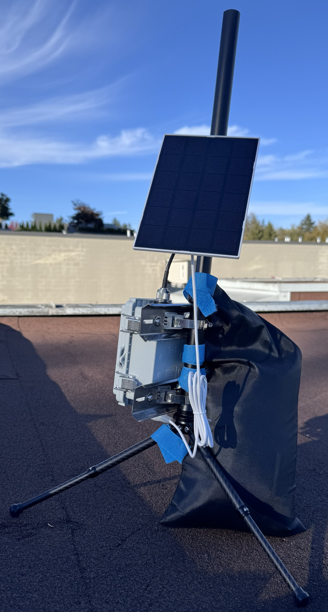
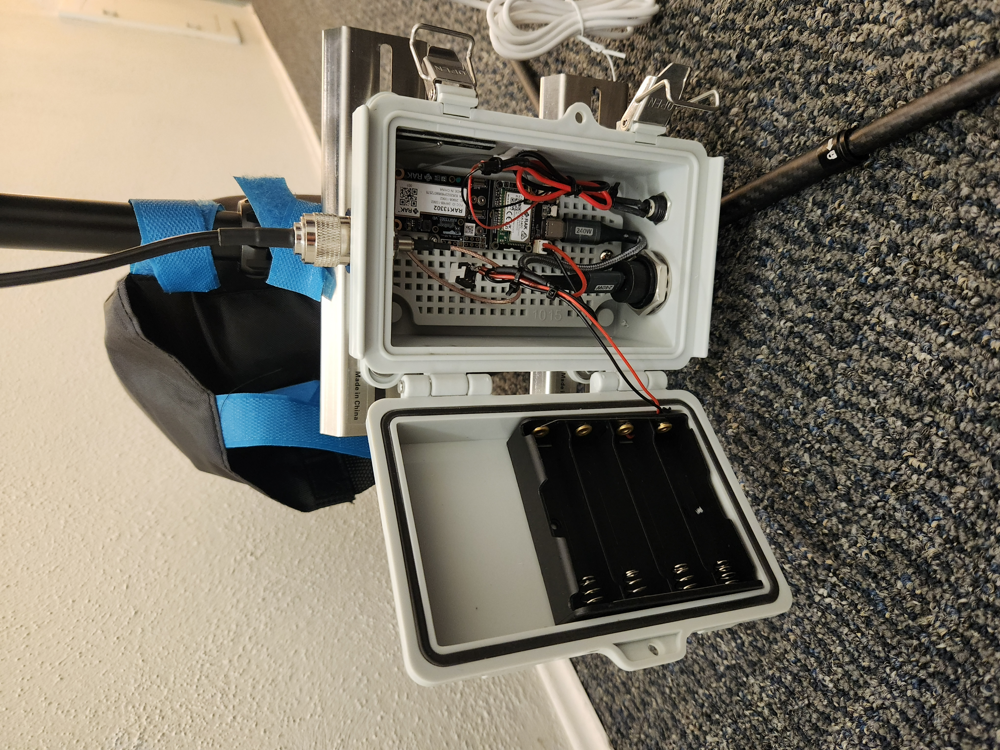

# MeshCore Repeater <!-- omit from toc -->

- [Summary](#summary)
  - [What's the purpose of MeshCore?](#whats-the-purpose-of-meshcore)
  - [Does it have any other functionalities? Like Eartquake detection?](#does-it-have-any-other-functionalities-like-eartquake-detection)
- [Project Overview](#project-overview)
- [Parts List](#parts-list)
  - [Main Parts](#main-parts)
  - [Enclosure](#enclosure)
  - [Power Management](#power-management)

## Summary

[MeshCore](https://meshcore.io/) has been described as "off-grid SMS messaging." People are able to message each other through devices that use the [ISM](https://en.wikipedia.org/wiki/ISM_radio_band) frequency band. These devices form a Mesh, hence the name **MeshCore**.

However, for these devices to be able to talk to one another effectively, solar-powered **repeaters** are needed to expand the range of these MeshCore devices. Hence why I decided to build a **1 Watt Solar-Powered MeshCore Repeater**.

### What's the purpose of MeshCore?

In major emergencies and disaser, cell phone networks would probably be down due to power outages or overloaded due to overuse. MeshCore would alleviate this problem by providing an alternative mode of communication. Since thee devices are Solar- and battery-powered, they would work even in the event of severe power outages.

### Does it have any other functionalities? Like Eartquake detection?

Why yes! These MeshCore devices can also be used for [Earthquake detection](https://www.reddit.com/r/meshcore/comments/1wx45sv/a_new_meshcore_repeater_project_earthquake/)! My next step is to upgrade this repeater with eartquake detection capabilites.

## Project Overview

I decided to build a 1 Watt solar-powered and tripod-mounted MeshCore repeater. This way the repeater could be easily deployed or relocated as needed. Below is a picture of the repeater deployed to a rooftop.

## Parts List

The repeater is based around a [RAK WisMesh 1W Booster kit](https://store.rakwireless.com/products/meshtastic-1w-lora-booster-kit-rak3401?variant=46639158657222).

**NOTE:** if any of the links are out of date, please let me know!

Below is an image of the components that are inside the repeater's enclosure.

### Main Parts

TODO

### Enclosure

TODO

### Power Management

TODO
